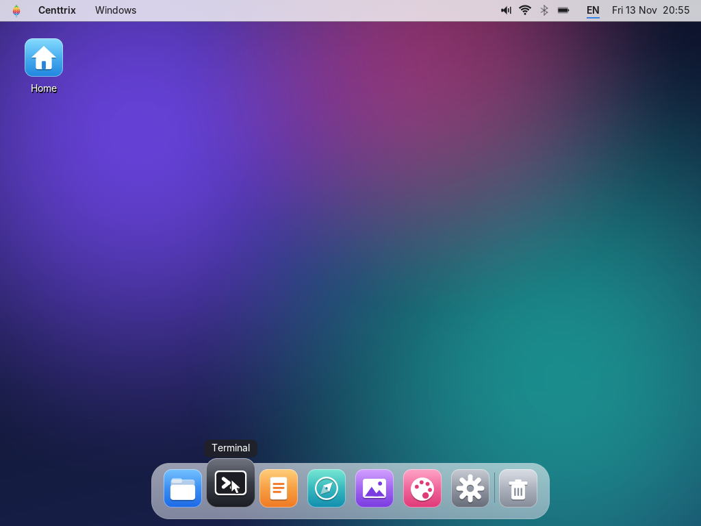

# Centtrix OS 4.0

**Экспериментальная 64-битная ОС: свой десктоп, оконный менеджер, файловая
система и приложения — всё на NASM, одним ядром без внешних зависимостей.**

Загружается в Legacy/CSM (x86-64 long mode, VBE 32bpp), работает с диска
ATA, есть сеть (Intel e1000), терминал с командами, редактор, файлы,
браузер, XPL-скрипты и тайловый WM `testland`.

## Что нового в 4.0
* **testland** — тайловый оконный менеджер: тёмный рабочий
  стол, верхняя панель с номерами воркспейсов, заголовком окна и часами,
  плоские заголовки окон, рамка фокуса и вкладки для нескольких окон.
* Файловая система **CNT3** (ATA, кэш, суперблок, каталоги) вместо старого
  слоя на 32 слотах; файлы и каталоги сохраняются между перезагрузками.
* Обновлены версии в интерфейсе, баннере и `system.txt`: **Centtrix 4.0**.
* Сборка через `build.sh` (патч исходников) сохраняет пользовательскую ФС:
  при пересборке перезаписываются только сектора ядра.

## Сборка и запуск
    ./build.sh               # src/patch.py -> centtrix_plus.asm -> nasm -> centtrix.img
    ./build.sh lite          # без BIGFS, ядро меньше
    ./run.sh                 # QEMU с сетевой картой e1000
    ./run.sh install         # QEMU + второй пустой диск для установщика
    ./tools/newdisk.sh       # чистая ФС и аккаунт (засеется при загрузке)
    sudo ./usb.sh /dev/sdX   # записать на флешку (стирает её), Legacy/CSM

`build.sh` при переполнении ядра сам пробует lite-сборку. Нужны `nasm` и
`python3`. Образ — 64 МБ, ядро занимает сектора 1..831, ФС начинается с 896.

## testland: тайловый режим
Запуск и выход — из терминала:

    testland
    testland off

Панель сверху: слева воркспейсы `1..4`, в центре заголовок активного окна,
справа часы. Клик по номеру воркспейса тоже переключает рабочий стол.
Несколько окон одного воркспейса живут во вкладках под панелью — окна не
плавают и не перекрываются.

| Клавиши | Действие |
| --- | --- |
| `Super+Enter` | открыть терминал |
| `Super+E` | открыть «Файлы» |
| `Super+Q` | закрыть активное окно |
| `Super+H` / `Super+L`, стрелки | предыдущее / следующее окно (вкладка) |
| `Super+J` / `Super+K` | то же (вниз / вверх) |
| `Super+1..4` | перейти на воркспейс |
| `Super+Shift+1..4` | отправить активное окно на воркспейс |
| `Super+Shift+Q` | выйти из testland |

## Установка на диск
В терминале:

    setup

Откроется графический установщик: список дисков (кроме загрузочного),
подтверждение, живой прогресс копирования и перезагрузка по завершении.
Установщик копирует всю систему (загрузчик, ядро и ФС) через BIOS, поэтому
подходит диск другого размера. Для проверки в QEMU: `./run.sh install`.

## Возможности
* **Рабочий стол**: обои, значки, док с магнификацией, меню-бар, темы,
  переключение языка, часы, настройки.
* **Терминал**: команды `ls`, `cd`, `cat`, `cp`, `rm`, `new`, `edit`, `run`,
  `wget`/`curl`, `bigfs`, `setup`, `install`, `testland` и другие (`help`).
* **Редактор**: vim-подобный (`i` — вставка, `Esc` — нормальный режим,
  `:w`, `:q`, `:r` для запуска `.xep`).
* **XPL**: встроенный язык скриптов (`say`, `box`, `color`, `repeat`, ...).
* **Файлы**: просмотр каталогов и файлов, запуск `.xep`, удаление.
* **Браузер**: простой HTML-браузер, `s` — сохранить страницу в файл.
* **Загрузки**: `wget URL [имя]`, `curl URL [имя]`; тело ответа пишется
  как есть. До 16 КБ — в CNT3, больше — в BIGFS (если отформатирован).
* **BIGFS**: до 16 МБ на диске с сектора 4096:
  `bigfs format yes | info | ls | cat ИМЯ | rm ИМЯ`.

## Файловая система CNT3
* Суперблок на секторе 896, FAT на 512 секторов, кластеры по 32 сектора.
* Файлы и каталоги: `/base` (системные), `/home` (пользователь), `/dump`
  (удалённое), `/base/www` (примеры страниц).
* Весь блочный ввод-вывод идёт через ATA (по одному сектору за вызов) с
  откатом на BIOS `int 13h`, если ATA недоступен.
* `tools/newdisk.sh` зануляет суперблок: при следующей загрузке ФС и аккаунт
  создаются заново.

## Проверка
`tools/qtest.py` — набор для QEMU (HMP/QMP): загрузка, разблокировка,
логин, клавиатура, мышь, скриншоты.

    python3 tools/qtest.py        # примеры в конце файла

`test.sh` собирает `selftest.img` с самопроверкой (BIGFS, HTTP, запись в ФС,
чтение с диска) и пишет отчёт в COM1; последняя строка — `SELFTEST OK`.

## Структура
    centtrix.asm        ядро (загрузчик, long mode, драйверы, GUI, приложения)
    src/patch.py        применяет патч и подключает модули к ядру
    src/anim.inc        анимации окон
    src/cntfs.inc       файловая система CNT3
    src/bigfs.inc       хранилище больших файлов
    src/download.inc    wget/curl и сохранение из браузера
    src/testland.inc    тайловый WM
    src/installer.inc   графический установщик
    src/selftest.inc    самопроверка для test.sh
    build.sh            сборка образа
    run.sh              запуск в QEMU
    tools/              тесты и подготовка диска

## Ограничения
* Загрузка только Legacy/CSM, без UEFI.
* Сеть — только Intel e1000 (в QEMU `-nic user,model=e1000`).
* Окна приложений рисуют в поверхности фиксированного размера, поэтому
  testland тайлит их по одному на экран, а остальные держит во вкладках.
* BIGFS — отдельная область, в «Файлах» его файлы не видны.
* Установщик копирует образ целиком и не меняет размеры разделов.
